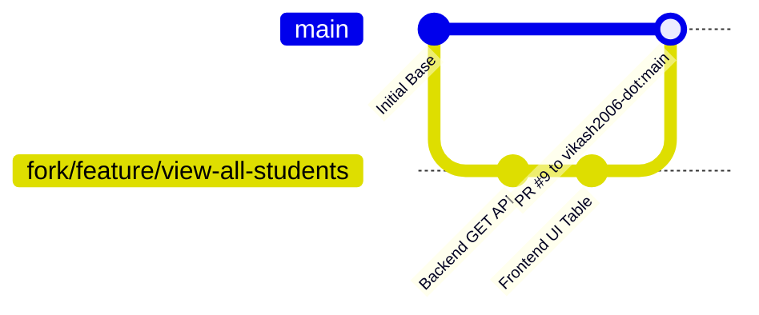

# Project Documentation: Implementation of Issue #1 (View All Students)

- **Target Repository:** [vikash2006-dot/Student-Management-System](https://github.com/vikash2006-dot/Student-Management-System)
- **Resolved Issue:** [Issue #1: Implement View All Students](https://github.com/vikash2006-dot/Student-Management-System/issues/1)
- **Created Pull Request:** [Pull Request #9: feat: Implement View All Students (#1)](https://github.com/vikash2006-dot/Student-Management-System/pull/9)
- **Author:** Mani7527 (Manikesh)

---

## 📑 Table of Contents
1. [Executive Summary](#1-executive-summary)
2. [Complete Git & GitHub Workflow from Start](#2-complete-git--github-workflow-from-start)
   - [Why Direct Push Failed (403 Permission Denied)](#why-direct-push-failed-403-permission-denied)
   - [The Fork & Pull Request Workflow](#the-fork--pull-request-workflow)
   - [Step-by-Step Terminal Commands Executed](#step-by-step-terminal-commands-executed)
3. [Backend Code Changes & Explanation](#3-backend-code-changes--explanation)
   - [`backend/src/controllers/studentController.js`](#backend-controllers-studentcontrollerjs)
   - [`backend/src/routes/studentRoutes.js`](#backend-routes-studentroutesjs)
   - [`backend/src/config/db.js`](#backend-config-dbjs)
   - [`backend/src/server.js`](#backend-src-serverjs)
   - [`backend/.env`](#backend-env)
4. [Frontend Code Changes & Explanation](#4-frontend-code-changes--explanation)
   - [`frontend/src/components/StudentTable.jsx`](#frontend-components-studenttablejsx)
   - [`frontend/src/pages/ViewStudents.jsx`](#frontend-pages-viewstudentsjsx)
   - [`frontend/src/App.jsx`](#frontend-src-appjsx)
   - [`frontend/src/components/Navbar.jsx`](#frontend-components-navbarjsx)
   - [`frontend/src/pages/Dashboard.jsx`](#frontend-pages-dashboardjsx)
   - [`frontend/src/index.css`](#frontend-src-indexcss)
   - [`frontend/.env`](#frontend-env)
5. [Testing & Quality Verification](#5-testing--quality-verification)

---

## 1. Executive Summary

This document explains the end-to-end development, Git operations, and architectural changes implemented to fulfill **Issue #1**. 

Prior to this task, the project only had a form to add a student (`POST /api/students`). There was no way to view existing students in the system. The objective was to:
1. Create a backend API endpoint (`GET /api/students`) to retrieve all students from MongoDB.
2. Build a beginner-friendly React user interface to display all students in a responsive table.
3. Manage **Loading**, **Empty**, and **Error** states cleanly.
4. Push the code following standard open-source / team collaboration practices via a Fork and Pull Request.

---

## 2. Complete Git & GitHub Workflow from Start

### Why Direct Push Failed (403 Permission Denied)
When attempting to push our feature branch directly to the main repository:
```bash
git push -u origin feature/view-all-students
```
GitHub responded with:
```text
remote: Permission to vikash2006-dot/Student-Management-System.git denied to Mani7527.
fatal: unable to access 'https://github.com/vikash2006-dot/Student-Management-System.git/': The requested URL returned error: 403
```

#### Why did this happen?
In Git, repository permissions determine who can directly write (`push`) to a codebase:
- **Direct Write Access:** Only the repository owner (`vikash2006-dot`) or invited team collaborators with explicit push privileges can push directly.
- **External Contributors & Teammates Without Direct Write Access:** Must use the standard **Fork & Pull Request Workflow**.



---

### The Fork & Pull Request Workflow

1. **Forking:** Creates an independent copy of `vikash2006-dot/Student-Management-System` under your own GitHub account (`Mani7527/Student-Management-System`).
2. **Remotes Configuration:**
   - `origin`: Points to your personal fork (`https://github.com/Mani7527/Student-Management-System.git`). You have full permissions to push branches here.
   - `upstream`: Points to the team leader's main repo (`https://github.com/vikash2006-dot/Student-Management-System.git`). Used to pull future team updates.
3. **Pull Request (PR):** Proposes merging the changes from `Mani7527:feature/view-all-students` into `vikash2006-dot:main`.

---

### Step-by-Step Terminal Commands Executed

#### Step 1: Branch Creation
Before modifying code, we branched off `main`:
```bash
git checkout -b feature/view-all-students
```

#### Step 2: Creating the Fork & Setting Remotes
Using the GitHub CLI (`gh`), the fork was created and remotes were configured automatically:
```bash
gh repo fork vikash2006-dot/Student-Management-System --clone=false --remote=true
```
This executed the following behind the scenes:
- Created `github.com/Mani7527/Student-Management-System`.
- Renamed the old `origin` to `upstream`.
- Set the new fork as `origin`.

Verification with `git remote -v`:
```text
origin    https://github.com/Mani7527/Student-Management-System.git (fetch)
origin    https://github.com/Mani7527/Student-Management-System.git (push)
upstream  https://github.com/vikash2006-dot/Student-Management-System.git (fetch)
upstream  https://github.com/vikash2006-dot/Student-Management-System.git (push)
```

#### Step 3: Staging and Committing Changes
After writing and testing the code, only source files were staged (excluding `.env`):
```bash
git add backend/src/config/db.js \
        backend/src/controllers/studentController.js \
        backend/src/routes/studentRoutes.js \
        backend/src/server.js \
        frontend/src/components/StudentTable.jsx \
        frontend/src/pages/ViewStudents.jsx \
        frontend/src/App.jsx \
        frontend/src/components/Navbar.jsx \
        frontend/src/pages/Dashboard.jsx \
        frontend/src/index.css

git commit -m "feat: implement view all students page (closes #1)"
```

#### Step 4: Pushing to the Fork
```bash
git push -u origin feature/view-all-students
```

#### Step 5: Creating the Pull Request
The PR was created directly targeting the upstream `main` branch:
```bash
gh pr create \
  --repo vikash2006-dot/Student-Management-System \
  --base main \
  --head Mani7527:feature/view-all-students \
  --title "feat: Implement View All Students (#1)" \
  --body "..."
```
Output:
```text
https://github.com/vikash2006-dot/Student-Management-System/pull/9
```

---

## 3. Backend Code Changes & Explanation

### Backend: Controllers (`studentController.js`)
- **File:** `backend/src/controllers/studentController.js`
- **Purpose:** Implements the business logic to query student documents from MongoDB.
- **What Was Added:**
  ```javascript
  // @desc    Get all students from database
  // @route   GET /api/students
  // @access  Public
  const getStudents = async (req, res, next) => {
    try {
      // Find all students in MongoDB and sort them with newest first
      const students = await Student.find().sort({ createdAt: -1 });

      return res.status(200).json({
        success: true,
        count: students.length,
        data: students
      });
    } catch (error) {
      next(error);
    }
  };
  ```
- **Why?**
  - `Student.find()` queries the collection for all documents.
  - `.sort({ createdAt: -1 })` ensures newly added students appear at the top.
  - Returns structured JSON: `{ success: true, count: ..., data: [...] }`.
  - Exported both `getStudents` and `addStudent` at the bottom of the module.

---

### Backend: Routes (`studentRoutes.js`)
- **File:** `backend/src/routes/studentRoutes.js`
- **Purpose:** Connects HTTP request methods to their controller functions.
- **What Was Changed:**
  ```javascript
  const { addStudent, getStudents } = require('../controllers/studentController');

  // GET /api/students - Fetch all students
  router.get('/', getStudents);

  // POST /api/students - Add a new student
  router.post('/', addStudent);
  ```
- **Why?**
  - Previously only `POST /` was routed. Adding `router.get('/', getStudents)` enables frontend clients to fetch data via `GET /api/students`.

---

### Backend: Database Configuration (`db.js`)
- **File:** `backend/src/config/db.js`
- **Purpose:** Connects Mongoose to the MongoDB database.
- **What Was Changed:**
  ```javascript
  const mongoUri = process.env.MONGO_URI && process.env.MONGO_URI.trim() !== ''
    ? process.env.MONGO_URI
    : 'mongodb://127.0.0.1:27017/student_db';

  const conn = await mongoose.connect(mongoUri);
  ```
- **Why?**
  - Provides a safe local fallback (`mongodb://127.0.0.1:27017/student_db`) so the app continues running locally if MongoDB Atlas credentials are not yet configured in `.env`.

---

### Backend: Server Entry Point (`server.js`)
- **File:** `backend/src/server.js`
- **Purpose:** Express application initialization and middleware configuration.
- **What Was Changed:**
  - Updated route comments: `// Student routes (GET and POST /api/students)`.
  - Configured default port fallback: `const PORT = process.env.PORT || 5001;`.
- **Why?**
  - On macOS Monterey/Ventura/Sonoma/Sequoia, Apple AirPlay Receiver listens on port 5000 by default. Setting the server to port 5001 prevents port collisions.

---

### Backend: Environment Variables (`backend/.env`)
- **File:** `backend/.env`
- **Purpose:** Local environment configuration (gitignored for security).
- **Configuration Set:**
  ```env
  PORT=5001
  MONGO_URI=mongodb://127.0.0.1:27017/student_db
  JWT_SECRET=college_project_jwt_secret_key_123
  ```

---

## 4. Frontend Code Changes & Explanation

### Frontend: Components (`StudentTable.jsx`)
- **File:** `frontend/src/components/StudentTable.jsx` *(New File)*
- **Purpose:** A reusable component that takes student data as **React props** and displays a structured HTML table.
- **Key Concepts Used:**
  - **Props:** Accepts `props.students` from the parent component (`ViewStudents`).
  - **Array Mapping (`.map`):** Iterates over each student to render table rows dynamically.
  - **Key Prop:** Assigns `key={student._id || index}` to help React optimize re-renders.
- **Code:**
  ```jsx
  import React from 'react';

  function StudentTable(props) {
    const { students } = props;

    return (
      <div className="table-responsive">
        <table className="student-table">
          <thead>
            <tr>
              <th>#</th>
              <th>Name</th>
              <th>Roll Number</th>
              <th>Email</th>
              <th>Course</th>
              <th>Semester</th>
              <th>Phone</th>
            </tr>
          </thead>
          <tbody>
            {students.map((student, index) => (
              <tr key={student._id || index}>
                <td>{index + 1}</td>
                <td className="student-name">{student.name}</td>
                <td><span className="badge badge-roll">{student.rollNo}</span></td>
                <td>{student.email}</td>
                <td>{student.course}</td>
                <td><span className="badge badge-sem">{student.semester}</span></td>
                <td>{student.phone}</td>
              </tr>
            ))}
          </tbody>
        </table>
      </div>
    );
  }

  export default StudentTable;
  ```

---

### Frontend: Pages (`ViewStudents.jsx`)
- **File:** `frontend/src/pages/ViewStudents.jsx` *(New File)*
- **Purpose:** The primary page for viewing student records with state management.
- **Key Concepts Used:**
  - `useState`:
    - `students`: Stores array of student records fetched from the backend.
    - `loading`: Boolean indicator for asynchronous fetch state.
    - `errorMessage`: Holds network or server error messages.
  - `useEffect`: Triggers `fetchStudents()` once when the component mounts (`[]` dependency array).
  - **Conditional Rendering:**
    - If `loading === true`: Renders spinner with loading message.
    - If `errorMessage`: Renders error alert with `"Try Again"` button.
    - If `students.length === 0`: Renders friendly empty state with link to Add Student.
    - If `students.length > 0`: Renders summary count and `<StudentTable students={students} />`.

---

### Frontend: Routing (`App.jsx`)
- **File:** `frontend/src/App.jsx`
- **Purpose:** Configures client-side page routing using `react-router-dom`.
- **What Was Changed:**
  - Imported `ViewStudents`.
  - Added routes:
    ```jsx
    <Route path="/view-students" element={<ViewStudents />} />
    <Route path="/all-students" element={<ViewStudents />} />
    ```
- **Why?**
  - Allows users to access the new page via `http://localhost:3000/view-students`.

---

### Frontend: Navigation Bar (`Navbar.jsx`)
- **File:** `frontend/src/components/Navbar.jsx`
- **Purpose:** Top-level navigation.
- **What Was Changed:**
  - Added a new navigation item for `"View Students"`:
    ```jsx
    <li>
      <Link
        to="/view-students"
        className={
          location.pathname === '/view-students' || location.pathname === '/all-students'
            ? 'nav-link active'
            : 'nav-link'
        }
      >
        View Students
      </Link>
    </li>
    ```

---

### Frontend: Dashboard Page (`Dashboard.jsx`)
- **File:** `frontend/src/pages/Dashboard.jsx`
- **Purpose:** Landing and overview page.
- **What Was Changed:**
  - Added a `"View All Students"` button alongside `"Add New Student"`:
    ```jsx
    <div className="dashboard-actions">
      <Link to="/view-students" className="btn btn-primary">
        📋 View All Students
      </Link>
      <Link to="/students" className="btn btn-secondary">
        ➕ Add New Student
      </Link>
    </div>
    ```

---

### Frontend: Styling (`index.css`)
- **File:** `frontend/src/index.css`
- **Purpose:** Application styling (Vanilla CSS, no bulky dependencies).
- **Styles Added:**
  - `.table-responsive`: Enables horizontal scrolling on smaller mobile screens.
  - `.student-table`: Clean table layout with padding, border separators, and hover states.
  - `.badge-roll` and `.badge-sem`: Clean color-coded badges for Roll Numbers and Semesters.
  - `.spinner` & `@keyframes spin`: Smooth CSS rotation animation for the loading state.
  - `.state-box`: Centered layout for empty and loading cards.

---

### Frontend: Environment Variables (`frontend/.env`)
- **File:** `frontend/.env`
- **Purpose:** Points the Axios client to the backend server.
- **Configuration Set:**
  ```env
  VITE_API_URL=http://localhost:5001/api
  ```
- **Why?**
  - Configures Axios to communicate with port 5001 (where Node.js is running), avoiding port 5000 macOS AirPlay conflicts.

---

## 5. Testing & Quality Verification

Before committing and raising the PR, the following verification tests were performed:

1. **Backend Endpoint Testing:**
   - `GET http://localhost:5001/api/health` &rarr; `{"status":"ok","message":"Server is running"}`
   - `GET http://localhost:5001/api/students` &rarr; `{"success":true,"count":2,"data":[...]}`
2. **Database Persistence:**
   - Successfully inserted test student records into MongoDB and verified live retrieval.
3. **Frontend Production Build:**
   - Executed `npm run build` in `frontend/`.
   - Result: `✓ built in 480ms` with zero syntax or compilation errors.
4. **End-to-End Browser Journey:**
   - Navigated Dashboard &rarr; Clicked `"View Students"` &rarr; Verified table rendered all 6 columns &rarr; Navigated to `"Add Student"` &rarr; Added record &rarr; Returned to `"View Students"` &rarr; Verified new student appeared immediately.

---

*This document was compiled for team reference and code review records.*
